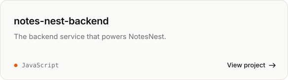
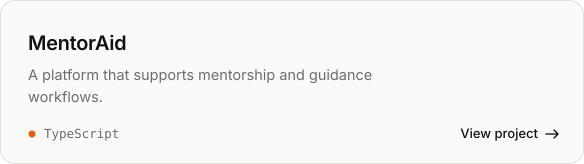
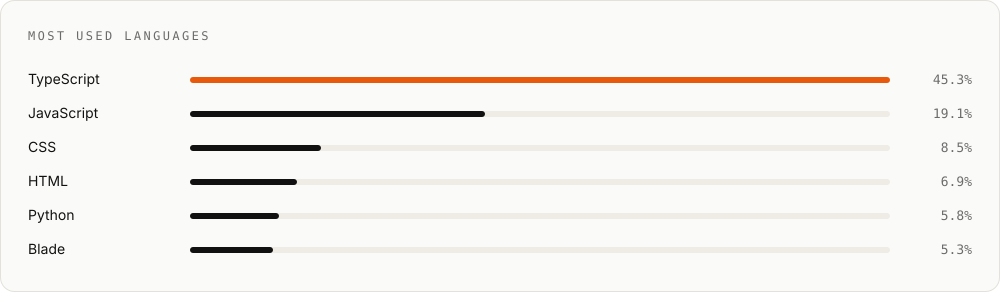

I'm a Computer Science student (B.Tech, graduating 2027) who builds simple, reliable products. My core stack is MERN, and lately I build with LLM APIs and automation tools to take real manual work off people's plates. I recently completed a Full Stack & AI internship at Larsen & Toubro.

[LinkedIn](https://www.linkedin.com/in/akhilkumarreddy09/)  |  [Email](mailto:akhilkumarreddy2006@gmail.com)  |  [Behance](https://www.behance.net/uppalbranch)

### Selected work

Also built: an email-to-Notion automation and voice AI pipelines in n8n.

### Stack

- **Frontend:** React, TypeScript, JavaScript, Vite, HTML, CSS
- **Backend and data:** Node.js, Express, MongoDB, Supabase
- **AI and automation:** Claude, OpenAI and Gemini APIs, n8n, Make
- **Other:** Python, Netlify

### Languages

### Contact

Open to full-stack and AI opportunities. The best way to reach me is [akhilkumarreddy2006@gmail.com](mailto:akhilkumarreddy2006@gmail.com).
