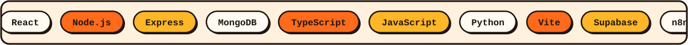

 

 

I'm a Computer Science student (B.Tech, graduating 2027) who turns ideas into simple, friendly products. My core stack is **MERN**. Lately I build with **LLM APIs** (Claude, OpenAI, Gemini) and automation tools like **n8n** and **Make** to take real manual work off people's plates.

I recently finished a Full Stack & AI internship at **Larsen & Toubro**, and I'm now deepening my skills in AI-assisted product building and automation pipelines.

Also built: an email-to-Notion automation and voice AI pipelines in n8n. Ask me about them.

  

  

<!-- Optional: contribution snake. Needs .github/workflows/snake.yml to run once. -->

 

